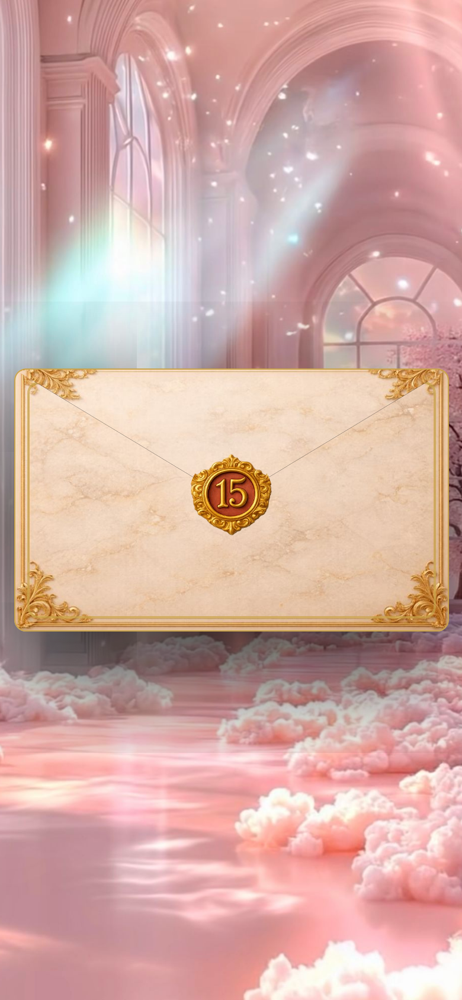
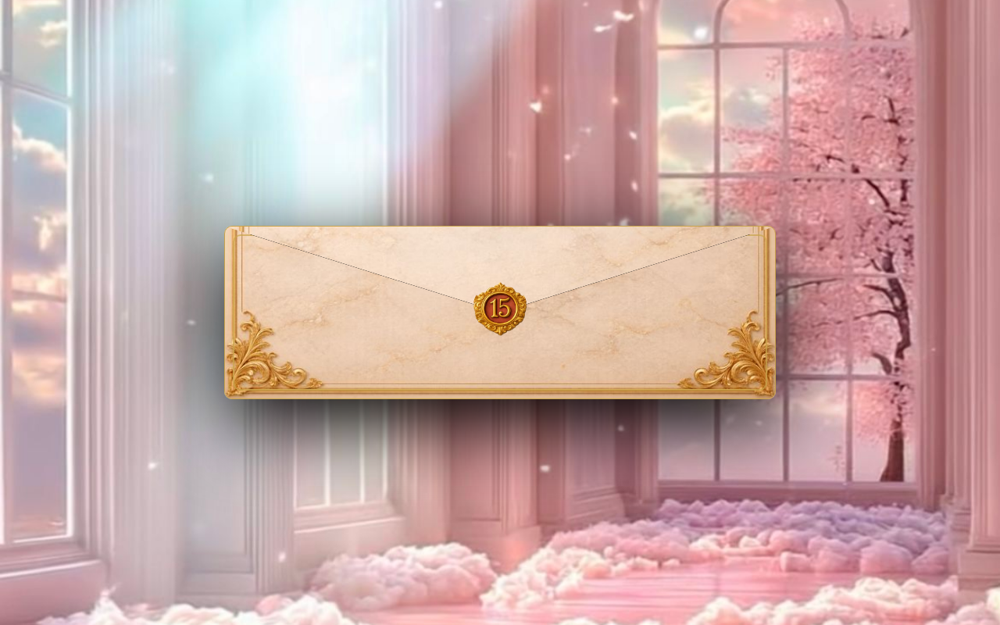

# Template de Invitaciones · Base reutilizable

La plantilla base de la que nacen las invitaciones de **Mirai**. En lugar de empezar cada proyecto desde cero, defino aquí la estructura, los componentes y el sistema de diseño, y cada evento solo cambia contenido y tema.

  
  &nbsp;&nbsp;
  

## El problema

Entregar decenas de invitaciones al mes con calidad constante. Copiar y pegar entre proyectos generaba errores y estilos inconsistentes.

## La solución

- **Sistema de diseño con tokens:** colores, tipografías, tamaños, espacios, gradientes, duraciones y z-index definidos en `variables.css`.
- **Componentes independientes:** sobre de bienvenida, cuenta regresiva, línea de tiempo, galería, tarjetas de lugar, código de vestimenta, mesa de regalos y RSVP.
- **Un solo punto de configuración:** los datos del cliente (nombre, fecha ISO, WhatsApp, acompañantes, cuenta) viven en un objeto `CONFIG` al inicio del script.
- **CSS en capas:** `variables → layout → components → envelope → style → responsive`, para saber siempre dónde vive cada regla.
- **Mobile-first** con breakpoints en 480, 768, 1024 y 1280 px.

## Secciones incluidas

Portada · Bienvenida · Cuenta regresiva · Historia · Familia · Itinerario · Calendario · Galería · Ceremonia · Recepción · Vestimenta · Regalos · RSVP · Extras

## Resultado

Tiempo de entrega más corto y una calidad visual consistente entre proyectos. La misma base se adapta a XV años, bodas, bautizos o cumpleaños cambiando solo el tema.

## Stack

HTML5 · CSS3 · JavaScript vanilla · Netlify

---

Diseñado y desarrollado por **Adair Kevin** · Mirai
